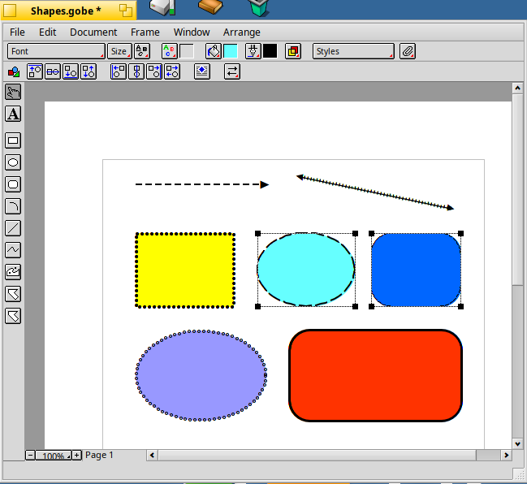
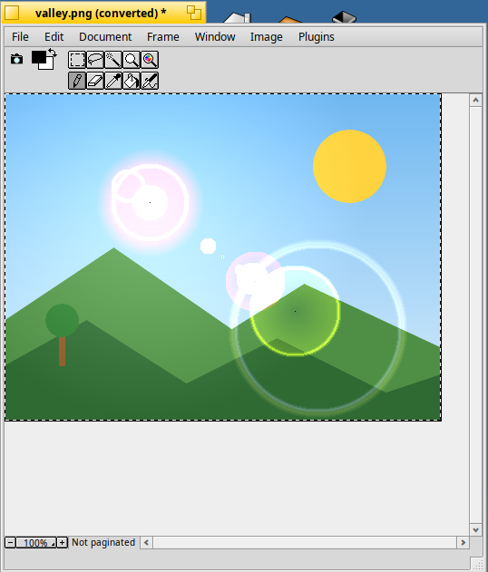
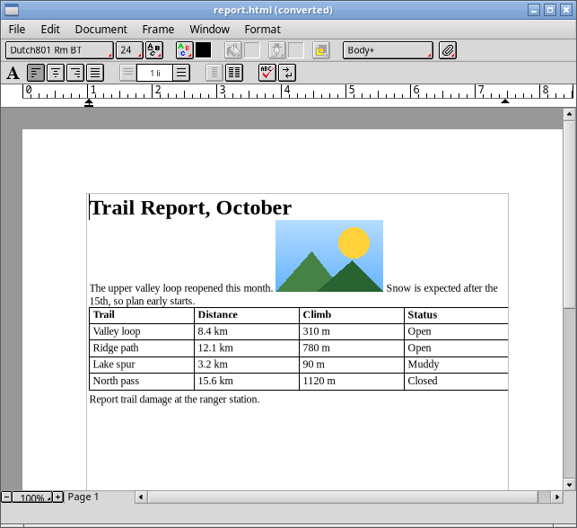
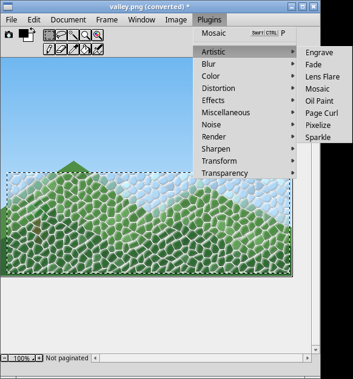
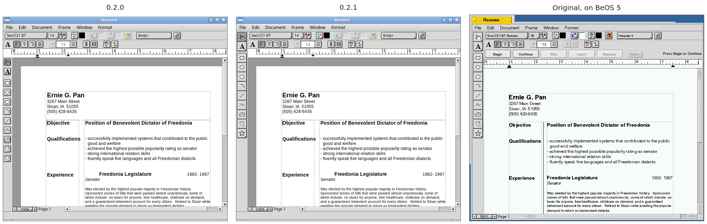
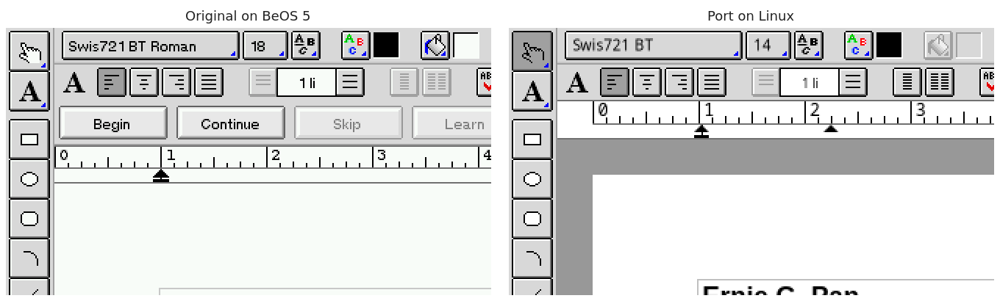

# Gobe Productive, ported

Gobe Productive 2.0.1, the integrated office suite for BeOS, rebuilt for
today's systems: **Haiku** (and Renku OS) and **Linux** (X11 and Wayland),
on x86_64 (and arm64 on Linux). One document can hold text, spreadsheets, drawings,
charts, pictures and slides, each in a frame of its own, the way Gobe
did it in 1999. The port opens and saves Gobe Productive documents and
works like the original, down to its menus and dialogs.

Every feature of the original is ported: the bar counts the [features](#features).

> **Unofficial.** This is an independent reimplementation, not affiliated
> with Gobe Software or the current owners of Gobe Productive. It contains
> **no part of the original program**: no code, menus, dialogs, pictures,
> sample documents or dictionaries. It needs your own copy of the original
> (below). See [LICENSE](LICENSE) for the licence and the full notice.

## What it does

[Features](#features) has the full list, area by area.

**Word processing.** Styles and the style sheet, the FormatBar and ruler,
tabs, columns, headers and footers, footnotes and endnotes, live fields, find and replace,
spelling, Word Count, the thesaurus and dictionary, History and Undo.

**Spreadsheets.** Formulas and the original's functions, cell formats,
borders, sorting and fill, sheets in tabs, and Make Chart for charts of
the selected cells.

**Drawing.** The ToolBar's shapes, lines, curves and Bezier paths:
select, move, resize, rotate, reshape, align, group, lock, give them the
original's fill and pen inks, dashed, dotted and hashed pens and arrows.

**Frames.** Text, spreadsheet, drawing, table and picture frames dragged
out anywhere in a document, text wrapped around them, text frames linked
so the text flows on. Open Frame Window edits a frame on its own.
Tables are made with Insert Table… and edited with the Table menu.
Pictures dropped or pasted into a document go in as picture frames.

**Images.** Image processing documents, new or opened from any picture
the system can read (PNG, JPEG, GIF, BMP, TIFF, WebP…): the painting
tools (pencil, airbrush, eraser, bucket, eyedropper, magnify), selections
(marquee, lasso, magic wand, Find Color) that move, float, crop and
invert, and the original's plug-in filters: the ImageManip add-ons and the
GIMP filters Gobe shipped, built from their sources, with their settings,
previews and progress. Edit Externally… hands an image to another editor
and takes it back.

*On Haiku: a picture opened as an image document, the GIMP Lens Flare filter applied.*

**Presentations.** File > New makes a presentation the way the original
did, and the original's presentations open and show their slides in the
document. The Presentation window adds, names and orders slides and
their layers; Start shows them full screen with their transitions, as
the original does.

**Inks and pens.** The original's colours, patterns, gradients and
transparency, its pen types and widths, the Inks window with ink sets and
editors for each kind.

**Other formats.** Word 97 and later, Excel, RTF, HTML, SYLK and text
tables open and save; Word, RTF and HTML keep their tables and pictures.
Styles can be exported to a file and imported into another document.

*On Linux (X11): an HTML page opened with its table and picture.*

*On Linux (X11): the Mosaic filter applied to a selection, and the Plugins menu by category.*

## Next to the original

The port is checked against Gobe Productive 2.0.1 running on BeOS 5.
Doing so after 0.2.0 showed its ToolBar was drawn wrongly: small buttons
with gaps, under the other bars. 0.2.1 draws it as the original does: 28-pixel buttons edge to edge, in a column down the left
beside every bar, with the pop-up triangle on the arrow, part and shapes
tools (whose icon is its shape, the star). The pop-up triangles are blue,
as in the original, not red, and the zoom box's "100%" fits in its box.
Here is the Resume sample in 0.2.0, the original and 0.2.1, with the
ToolBar shown:

The bars close up, at twice the size:

*Still different: the original saves which bars a document shows (the
Resume opens with the spelling bar on BeOS), which the port doesn't read
yet; the fonts are today's, so text looks a little different; and BeOS
here ran in 16-bit colour, which tints white slightly green. The port is
shown on Linux.*

## Install

The current release is **1.0.0**, the whole of Gobe Productive: since
0.2.1, image processing (the painting tools, selections, the plug-in
filters, Edit Externally…, pictures opened as images), tables, charts in
2D and 3D, slide shows, Views & Layers, the graphics ruler, tear-off
palettes, the Status window, the Missing Fonts dialog and every dialog of
the original the earlier releases lacked.

| System | Download | Install |
|---|---|---|
| Haiku R1/beta6, Renku OS (x86_64) | [gobeproductive-1.0.0-1-x86_64.hpkg](https://github.com/idumych/gobe-productive/releases/download/v1.0.0/gobeproductive-1.0.0-1-x86_64.hpkg) | `pkgman install ./gobeproductive-1.0.0-1-x86_64.hpkg` |
| Linux, glibc 2.39+ (x86_64) | [GobeProductive-1.0.0-x86_64.AppImage](https://github.com/idumych/gobe-productive/releases/download/v1.0.0/GobeProductive-1.0.0-x86_64.AppImage) | `chmod +x GobeProductive-1.0.0-x86_64.AppImage`, then run it |
| Linux, glibc 2.39+ (aarch64) | [GobeProductive-1.0.0-aarch64.AppImage](https://github.com/idumych/gobe-productive/releases/download/v1.0.0/GobeProductive-1.0.0-aarch64.AppImage) | `chmod +x GobeProductive-1.0.0-aarch64.AppImage`, then run it |

Checksums and release notes are on the
[release page](https://github.com/idumych/gobe-productive/releases/tag/v1.0.0).
On Haiku it appears in the Deskbar's Applications menu. The Command key is
**Alt** on Haiku and **Ctrl** on Linux.

Documents lay out with the Liberation fonts, which have the widths of the
Times, Helvetica and Courier designs of BeOS's Bitstream fonts: the Haiku
package installs them (`liberation_fonts`) and the AppImage brings them
along. Without them the port falls back to Noto, whose lines are wider and
taller, so text breaks in other places than it did in Gobe and can run out
of its frames.

### You need the original Gobe Productive 2.0

The port reads the original's menus, dialogs, strings and pictures (and its
dictionaries, help and samples) from your own copy at runtime. The original
can't be installed on any current system, so the port unpacks it itself
from what you have:

- the Gobe Productive **CD image** (an `.iso` file), or
- its **installer**, the file named `Install Gobe Productive` (from the CD
  or the download), or
- a **folder** copied from the CD or from an old BeOS installation (the
  `Gobe Productive 2.0` folder, or any folder holding the installer).

On first start, if it doesn't find it, the port says so: click **Locate…**
and choose the image, the installer or the folder. It unpacks the original
into its settings folder and remembers it, so this happens once:

| System | Unpacked into |
|---|---|
| Haiku, Renku OS | `~/config/settings/Gobe Productive port/Original` |
| Linux | `~/.config/cosmoe/Gobe Productive port/Original` |

It also looks on its own in the usual places (`~/Gobe Productive 2.0`,
`~/config/non-packaged/apps/Gobe Productive 2.0`, `/boot/apps/…`, next to
the app), and you can name the image, installer or program in the
`GOBE_ORIGINAL` environment variable.

BeOS-format (BFS) CD images can't be read yet: copy the installer or the
folder out of the image first (Haiku can mount it), and choose that.

### Where 1.0.0 was tested

| System | What was tested |
|---|---|
| Haiku R1/beta6 (x86_64) | Installed the package (it brought the Liberation fonts), unpacked the original from its installer, opened a document, typed, saved and quit, reopened it, Edit Styles; opened a PNG as an image document |
| Linux x86_64, X11 | The AppImage (Xvfb and Openbox): unpacked the original from its installer, opened a document, typed, saved, quit and reopened it, Edit Styles from the style menu; opened a PNG as an image document |
| Linux, Wayland | Started on headless sway (x86_64 and aarch64): the window appears |
| Linux aarch64, X11 | Started on an arm64 machine: the window appears |
| Renku OS | Not tried; the Haiku package should install there |

There's no Haiku arm64 package yet. The other features, the plug-in
filters and the rest of image processing among them, were tried during
development in a Haiku R1/beta6 VM, on Linux and by the host tests, not on
the release builds. Also untested so far: real hardware, interactive
Wayland desktops (beyond opening pictures with a development AppImage),
drag and drop from a Linux file manager, real Gobe Productive CD images
(only images made from the installer), and opening documents saved by the
port in the original on BeOS.

## The thesaurus and dictionary

Gobe Productive's Thesaurus… and Dictionary… read the thesaurus and
dictionary files BeOS kept in `/boot/optional/goodies`, which aren't
available any more. The port reads files in the same formats made from
[WordNet 3.0](https://wordnet.princeton.edu) instead: download its
database (`WNdb-3.0.tar.gz`), unpack it, and run

    tools/wordnet_to_gobe.py <the unpacked dict folder> <a folder>

then put the `thesaurus` and `dictionary` it writes into the port's
settings folder (`~/config/settings/Gobe Productive port` on Haiku,
`~/.config/cosmoe/Gobe Productive port` on Linux). WordNet's licence
comes with them (`LICENSE-WordNet`) and must stay with the files.

## Features

What the original Gobe Productive 2.0.1 does, area by area. The list
came from checking every menu command and dialog of the original (the
main program and each part), and the menus its code builds (context
menus, tear-off menus), against the port; every one is done.

### Documents and windows

| Feature | State |
|---|---|
| Opening and saving Gobe Productive documents; only what was edited is rewritten, everything else is kept byte for byte | done |
| File menu: New (word processing), Open Recent, Revert, Insert… (text and RTF), Page Setup, Print, Help (the original's User's Guide), About | done |
| File > New spreadsheets, laid out as the original's (rows 1-500, columns A-T, its grid and heading styles) | done |
| File > New drawings: an empty page as the original makes it | done |
| File > New presentations: one blank slide on a "Background" layer, the screen's size, as the original makes it | done |
| Sheets: the SheetBar, a tab per sheet; New Sheet…, Delete Sheet, Rename Sheet…, tabs dragged to reorder, all undoable | done |
| Show Clipboard (Window menu): the last copied text with its styles, or cells with their values | done |
| New Window: more windows on a document (titled "name:1", "name:2"), each scrolled, zoomed and selected on its own, one undo history and saved state; an edit shows in all; the last window to close asks to save (the sheet shown is the document's, for all its windows) | done |
| The ToolBar (Window > Show ToolBar, shown at first in drawings): the original's tools in a column beside the document, the arrow and the shape tools working | done |
| The ToolBar's part tool: text, spreadsheet, drawing, table and picture frames dragged out in a drawing | done |
| The ToolBar's Bezier tool (a press a point, a drag its control points) and toolbar shapes (the original's shapes, chosen from its menu, dragged out) | done |
| The Missing Fonts dialog: a document using fonts that aren't installed says which (BeOS's Bitstream fonts count as there when the Liberation fonts, which have their widths, are) | done |
| Tear-off palettes: the FormatBar's menus dragged off into floating windows (Styles; Text Formatting from the font, size and face menus; Named Selections; Shape Transparency; each ink menu into the Inks window on its kind) and the zoom's slider dragged off into Scale | done |
| The Status window: progress while a file is imported or exported, with Cancel | done |

### Word processor

| Feature | State |
|---|---|
| Typing, selection (double, triple and quadruple clicks; the arrow keys with Command, Option and Control; Home/End, Page Up/Down), cut, copy and paste with styles, undo and redo, Find/Change, the context menu | done |
| Fonts, sizes, faces, colours, alignment, Paragraph Format, tabs, line and paragraph spacing, Copy/Paste Format, Show/Hide Invisibles | done |
| Pages that come and go with the text; margins, headers and footers; columns; line, frame and page breaks; separator lines | done |
| Page numbers, dates, times and formulas as live fields; footnotes and endnotes | done |
| Styles: applying paragraph and basic styles, New Style, Edit Styles (Modify, Copy, Cut, Paste and Clear Style, formatting a style directly) | done |
| Import Styles and Export Styles (Edit Styles' File menu): the styles picked, written as the original's styles files and read back | done |
| Spell checking with the original's dictionaries | done |
| Spreadsheet and drawing odds and ends: row and column sizes dragged at the headings, the SheetBar's tab menu (rename, reorder), SYLK dates, HTML column spans (the cells after a span in their columns), short dashes drawn as marks, the frame window's white page | done |
| Writing Tools' Thesaurus… and Dictionary…, on files made from WordNet (see [The thesaurus and dictionary](#the-thesaurus-and-dictionary)) | done |
| Word Count, the text ruler, the FormatBar and PartBar, zoom, the browse view, Preferences, History, Document Size | done |

### Spreadsheets

With cells selected, the original's Format and Options menus appear and
work as they did, with its dialogs and alerts; the edits undo (display
options and Auto Calculate are settings, as in the original), and locks,
sizes, headings and options are saved with the document.

| Feature | State |
|---|---|
| Cells edited (values and formulas, evaluated), cut, copy and paste, Fill Down and Fill Right, rows inserted and deleted | done |
| The EntryBar (Enter, Tab, Escape, Accept and Cancel) and Paste Function (the original's functions by category, with their help) | done |
| Number…, Lock and Unlock Cells, Column Width… and Row Height… (or a heading's edge dragged), Display Options… | done |
| Fill Up and Left; Move Cells… (formulas and names follow); Insert Cells… and Delete Cells…, whole rows and columns (#REF! for deleted references); Sort… by up to three keys | done |
| Cells copied and pasted as cells (relative references adjusted), Paste Special…, Copy Format and Paste Format | done |
| Calculate Now, Auto Calculate, Go To Cell…; named selections (Name Selection…, Edit Names…, names in formulas) | done |
| The FormatBar and PartBar for cells: font, size, faces, colours, alignment, Wrap Text, borders (with Transparency > Other…), Number Formatting | done |
| Selecting rows, columns and every cell by the headings; several ranges at once with Command-click; Select Dependents | done |
| Charts made from cells: Make Chart (the PartBar's button, the cells' context menu) charts the selected cells as a 2D bar chart beside the data, series and categories named from the labels, linked to the cells; undoable, saved | done |

### Frames and drawing

| Feature | State |
|---|---|
| Viewing drawings, charts (2D), images, tables, clocks and presentations | done |
| Frames: selected by their edge; the Frame menu's parts, Make Linked Frame (text flowing on), Clone Frame, Autogrow and Scrollbars, undoable and saved | done |
| Frames: moved by the edge and resized by the handles, undoable; Open Frame Window (another window of the document showing just that frame); a growing frame as high as its text. Text wrapped around shapes and frames (Arrange > Text Wrap…: None, Regular, Tight, Top & Bottom, the side and the distances), by their boxes; Both Sides lays the text on the larger side | done |
| Drawing tools: rectangles, ellipses, round rectangles, arcs, lines, freehand and polygons dragged out in a drawing (a new drawing or a text document's sheet drawing); selected, moved, resized by a corner, deleted; undone, saved | done |
| Drawing tools: several shapes selected (Shift-click, a rubber band in a drawing), moved and deleted together; Arrange's Bring to Front, Send to Back, Move Forward and Move Backward; Rotate (a corner handle turns the shape) and Reshape (a path's points, a line's ends) | done |
| Drawing tools: Align Objects… (as the original, each choice tried at once), Align to Grid, Lock and Unlock, Draw Grid and AutoGrid (snapping), Create Outlines; a curve's control points reshaped; turned shapes hit by their turned outline | done |
| Drawing tools: Group and Ungroup (the shapes in a new drawing part, framed in their place; Ungroup puts them back), groups selected, moved and deleted as one | done |
| Pattern and gradient inks and transparency in the FormatBar for text and cells (the original's pattern and gradient sets) | done |
| Fill and pen inks for shapes in the FormatBar: colours, patterns and gradients for the fill and the pen, the fill's, pen's and shapes' transparency (with Other…), shown in its indicators | done |
| Fill and pen inks for frames in the FormatBar: a selected frame's fill (its background in a drawing), its pen (its border) and their transparency; the pen's size (Hairline to 8 pt, Other…) in the pen ink's menu, for shapes and frames | done |
| The drawing's PartBar: the vertical and horizontal align buttons (undoable), Text Wrap (its dialog), the arrows menu (none, at the start, at the end, both), arrowheads drawn at lines' and open paths' ends; the pen ink's pen types (Default, Non-Printing, small, medium and large dashes, hollow and filled dots, hash marks) applied, drawn and saved | done |
| Pens made, edited and deleted in the Inks window's pens (a click on the pen ink menu's pen icon; Edit > New Pen…, Edit Pen…, Clear; a double click applies one) with the pen dialog (name, kind, printable, gap and dash widths, a sample); a document's own pens saved and reloaded exactly and listed in the pen menu; the pen menu and the arrows menu marking what the selection has; very short dashes drawn as marks across, as the original draws them | done |
| Ink set files: the original's ink sets (its "Ink Sets" folder, SETF archives) read and written, a document's own sets | done |
| The Inks window's Kind menu (fill, pen and text ink) and its colours, patterns (bitmap patterns too), gradients and pens (opened by a click on an ink menu's icon; a click applies an ink); the Sets menu choosing among the application's sets, the ink set files and the document's own; the File menu's New Set…, Save Set, Save Set As…, Revert To Saved Set and Set Dimensions…; inks made, edited, cleared, cut, copied and pasted into the sets (a document's saved with it, a file's to its file) | done |
| Editing inks and pens in the Inks window: Cut, Copy and Paste, the pen view's width buttons and slider, a colour, pattern or gradient edited | done |
| Views & Layers…: a drawing's views (New View, Delete View, Rename View…, switching between them) and layers (New Layer, Delete Layer, Rename Layer…, the active layer), each layer shown, editable, locked or printed per view; new shapes go on the active layer | done |
| Context menus in drawings: on the page, Draw Grid, AutoGrid and Show or Hide Graphics Ruler; on a polygon or curve, Closed, Smooth, Unsmooth, Auto-Smooth, Add To Tool Bar and its handles' edits; on an arc, Closed, Start Angle… and Arc Angle…; on a round rectangle, Corner Radius…; on a group or frame, Ungroup and Open group; in Reshape, a point's Delete, Smooth, Unsmooth and Auto-Smooth Handle(s) and a control point's Delete Control(s) | done |
| Document > Document Size… for drawings (pages across and down), spreadsheets (rows and columns) and presentations (the slide size, with a pop-up of screen sizes); a new drawing is one page, as the original's are | done |
| The graphics ruler (Window > Show Graphics Ruler, or the drawing's context menu): rulers along the top and left of a drawing, in the sheet's unit, numbered on from page to page, with the unit menu on the right button | done |

### Presentations

| Feature | State |
|---|---|
| Slide shows: Start Presentation…, the Presentation window (Show Presentation Window…: Start, Start Here, the slides and their layers, dragged into place), its Options (Auto-start, Cursor); full screen with the cursor hidden, the original's keys | done |
| New Slide…, Duplicate Slide…, Rename Slide…, Delete Slide, and moving between slides | done |
| Slide transitions (Jump, Wipe, Venetian Blinds, Elevator Doors) and their Settings… | done |
| A presentation's layers: New Layer…, Duplicate Layer…, Rename Layer…, Delete Layer, a slide's layers from its pop-up | done |

### Tables

| Feature | State |
|---|---|
| The Table menu: Merge Cells, Split Cell…, Select Row, Select Column, Insert and Delete Row and Column, Distribute Rows and Columns Evenly, Cell Gutter…, and the cells' vertical alignment (top, center, bottom); cells selected by dragging across them | done |
| Insert Table… and the table's options (Cell Gutter…) | done |
| Editing a table: Tab and the arrows from cell to cell, rows growing and shrinking with their text, cells copied, cut and pasted (into the table or as a table of their own), rows and columns resized by dragging their edges with the original's pointers, the whole table by its frame's handle | done |

### Charts

| Feature | State |
|---|---|
| The Chart menu: Series In Rows, Show Legend, Show Title, Chart Type… (2D bar, line, area, stacked area, XY scatter and line; 3D bar, pie and 3D area, drawn with OpenGL as the original draws them) and Axis…; a chart entered with its PartBar and ribbon (for 3D charts the camera's tools: move it toward and away, sideways, around, and the pointer; the arrow, -, = and a, z keys), its plot, legend and title selected, moved and sized like shapes; the legend's context menu (a series' colour, symbols, colour of symbols, Display As, Bring Forward and Send Backward). (3D charts aren't drawn on Haiku arm64, which has no OpenGL) | done |

### Image processing

| Feature | State |
|---|---|
| New image processing documents (File > New, Image Processing) as the original makes them: a white image 512 points square, its window with the Image and Plugins menus and the PartBar's colors and tools; Document Size… (the image cut off or grown in the background color, light gray around it) | done |
| The painting tools: pencil, airbrush, eraser, paint bucket, eyedropper, find colour and magnify, with their settings; the foreground and background colours (edited, swapped, chosen from the colour set) | done |
| Selections: marquee, lasso and magic wand (Shift adds, Command takes away, both keep what's in both, Option leaves out the background colour) and Find Color; moved (Option copies), duplicated, floated and unfloated, inverted, deselected, deleted, cut, copied and pasted, moved a pixel with the arrow keys; Crop; pictures pasted and dropped in; the marching ants; the painting tools kept to the selection and working on floating bits | done |
| Plug-in filters: the ImageManip add-ons and the GIMP filters the original shipped (built from their GPL sources in `plugins/`), in the Plugins menu by category, each with its settings in the Plugin dialog (a live preview for the add-ons), its progress, its result kept to the selection as one undo step, its settings kept for next time, About… and Option for its credits, the last one at the top of the menu; Edit Externally… (Image menu and the image's context menu) with the editor the Image Processing preferences name; the Image Processing and Spreadsheet preference panels | done |

### Other formats (translators)

Opened with File > Open, saved with Save As's File Format menu.

| Feature | State |
|---|---|
| Plain text: opened and saved | done |
| RTF: opened and saved | done |
| RTF: pictures in the text saved (image parts, as PNG; the original wrote JPEG) | done |
| RTF: tables saved as RTF tables, and tables and pictures read back when an RTF file is opened | done |
| HTML: text documents opened and saved (paragraphs, headings, alignment, sizes, colours, faces, lists, rules, entities) | done |
| HTML: tables saved as tables (a table in the text, a table sheet), as the original wrote them | done |
| HTML: pictures in the text saved as PNG files in a "<name>.images" folder (image parts; the original drew any frame and wrote GIF or JPEG) | done |
| HTML: tables opened as tables (a table part in the text, its cells' text formatted, WIDTH, BORDER, CELLPADDING, tables in cells; a cell spanning columns keeps the cells after it in their columns, the spanned ones left empty: cells aren't merged) and pictures (PNG, and through the system's translators GIF, JPEG and the rest; else the ALT text) | done |
| Text tables: tab, comma or semicolon separated, opened as spreadsheets and saved from them (cells as shown, or formulas with Show Formulas on) | done |
| SYLK: opened and saved (values, R1C1 formulas, number formats, dates, column widths, row heights, the default font) | done |
| Microsoft Excel: Excel 5 and later workbooks opened (a sheet per worksheet, values, formulas, number formats, dates, widths, defined names as named selections); spreadsheets saved as Excel 97 | done |
| Microsoft Word: Word 97 and later documents opened (their style sheet applied: faces, sizes, fonts, colours, alignment, indents, spacing; line breaks, fields as their results) | done |
| Microsoft Word: text documents saved as Word 97 (text, faces, sizes, fonts, colours, alignment, indents, spacing, line and page breaks, fields as their text; not frames, tables or styles) | done |
| Microsoft Word: tables saved as Word tables and pictures saved in Word documents | done |

Ranges are written A1..B2, as Gobe Productive writes them (A1:B2 is still
understood).

Tested on Haiku R1/beta6 in a virtual machine, with the original's sample
documents. Documents saved by the port open in the port; they haven't
been tried in the original on BeOS. Word files the port saves are read
correctly by antiword (text, breaks, alignment, indents, faces) but
haven't been opened in Microsoft Word; Excel files open in xlrd but
haven't been opened in Excel; styles files haven't been tried in the
original.

## Building

The same sources build on both systems; the Makefile finds out which
one it's on.

- **Haiku:** `pkgman install gcc make haiku_devel zlib_devel mesa_devel`, then `make`.
- **Haiku arm64:** cross-built on Linux: `sh tools/haiku-arm64/make-sysroot.sh <dir>`
  once, then `. <dir>/env.sh && make HAIKU_CROSS=1 && sh packaging/build-hpkg-arm64.sh`.
  (There's no Mesa for Haiku arm64, so this build draws no 3D charts.)
- **Linux:** build [Hokku](https://github.com/idumych/hokku) (the Haiku API
  as a library, a fork of Cosmoe) with its OpenGL view (EGL and the GL
  headers), then `make COSMOE_ROOT=<its prefix>`.

Run `./GobeProductive [document…]`. `make test` runs the host-side tests of
the portable core (`src/core`, no Haiku API) on any system; with the
original's files at `../original/installed` they also run on its sample
documents. The packages are built by `packaging/` (`build-hpkg.sh` on
Haiku, `build-hpkg-arm64.sh` for Haiku arm64; `appimage.yml` in GitHub Actions).

| Path | Contents |
|---|---|
| `src/core/` | Portable C++17, no Haiku API: reading and writing documents, editing, styles, spreadsheet formulas, fields, spelling, text and RTF, the original's resources, unpacking the original (`OriginalImport`). |
| `src/app/` | The interface on the Haiku API: windows, menus and dialogs from the original's resources, the page view, the ribbons, the floaters. |
| `tests/` | Host-side tests. |

Test options (used by the test scripts): `--menu <index>`, `--dialog <id>`,
`--render out.png`, `--slide <n>`, `--do '<script>'` (see
`TPageView::RunScript`); `GOBE_DEBUG_MENUS=1` adds a menu of every dialog.

## Licence

MIT, with a notice: see [LICENSE](LICENSE). "Gobe Productive" is a trademark
of its owners.

The image plug-ins in [`plugins/`](plugins) are separate programs and
add-ons under their own licences, most of them the GNU General Public
License (see [plugins/README.md](plugins/README.md)); the packages ship them
with that licence.
