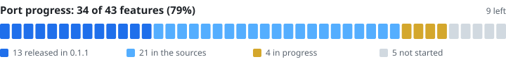
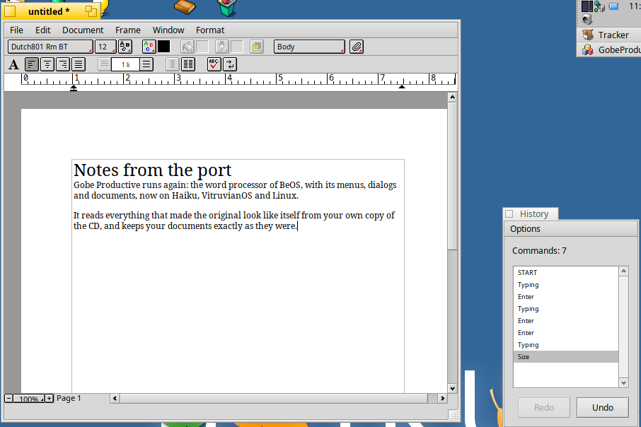
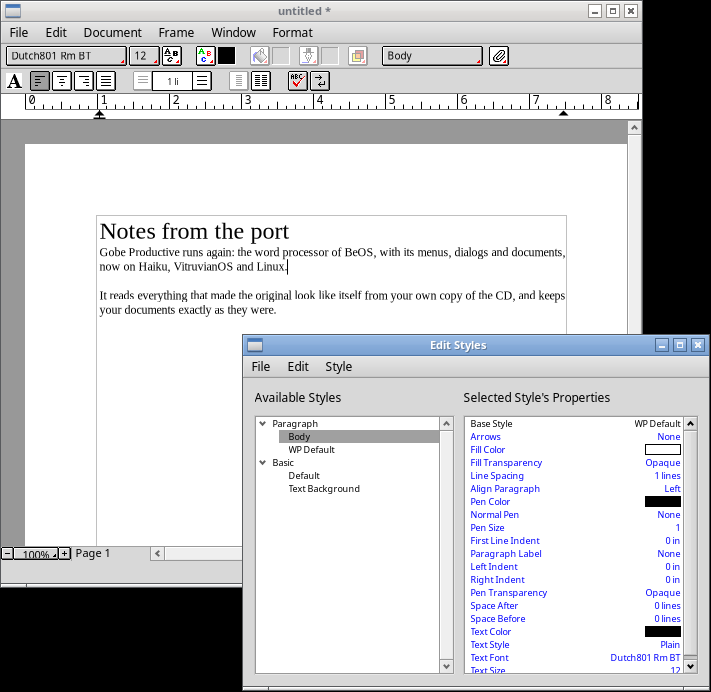

# Gobe Productive, ported

Gobe Productive 2.0.1, the office suite for BeOS, rebuilt to run on today's
systems: **Haiku** (and Renku OS) and **Linux** (X11 and Wayland). It opens and saves Gobe Productive
documents and works the way the original did, down to its menus and dialogs.

The released **preview** (0.1.1) is focused on the word processor. Since
then, spreadsheets have caught up with the original's editing, documents
have several sheets, styles can be exported and imported, and Word,
Excel, HTML, SYLK and text tables open and save (HTML and RTF with
their tables and pictures); that will be the next release.
[Status](#status) lists what works and what's left.

> **Unofficial.** This is an independent reimplementation, not affiliated
> with Gobe Software or the current owners of Gobe Productive. It contains
> **no part of the original program**: no code, menus, dialogs, pictures,
> sample documents or dictionaries. It needs your own copy of the original
> (below). See [LICENSE](LICENSE) for the licence and the full notice.

## You need the original Gobe Productive 2.0

The port reads the original's menus, dialogs, strings and pictures (and its
dictionaries, help and samples) from your own copy at runtime. The original
can't be installed on any current system, so the port unpacks it itself
from what you have:

- the Gobe Productive **CD image** (an `.iso` file), or
- its **installer**, the file named `Install Gobe Productive` (from the CD
  or the download), or
- a **folder** copied from the CD or from an old BeOS installation (the
  `Gobe Productive 2.0` folder, or any folder holding the installer).

On first start, if it doesn't find it, the port says so: click **Locate…**
and choose the image, the installer or the folder. It unpacks the original
into its settings folder and remembers it, so this happens once:

| System | Unpacked into |
|---|---|
| Haiku, Renku OS | `~/config/settings/Gobe Productive port/Original` |
| Linux | `~/.config/cosmoe/Gobe Productive port/Original` |

It also looks on its own in the usual places (`~/Gobe Productive 2.0`,
`~/config/non-packaged/apps/Gobe Productive 2.0`, `/boot/apps/…`, next to
the app), and you can name the image, installer or program in the
`GOBE_ORIGINAL` environment variable.

BeOS-format (BFS) CD images can't be read yet: copy the installer or the
folder out of the image first (Haiku can mount it), and choose that.

## Install

The current release is **0.1.1 (preview)**. It changes only the Linux
AppImage, which now draws like Haiku in the places where 0.1.0 didn't
(disabled buttons, icon backgrounds, the ruler) and closes a tooltip when
the pointer leaves the window.

| System | Download | Install |
|---|---|---|
| Haiku R1/beta6, Renku OS (x86_64) | [gobeproductive-0.1.1-1-x86_64.hpkg](https://github.com/idumych/gobe-productive/releases/download/v0.1.1/gobeproductive-0.1.1-1-x86_64.hpkg) | `pkgman install ./gobeproductive-0.1.1-1-x86_64.hpkg` |
| Linux, glibc 2.39+ (x86_64) | [GobeProductive-0.1.1-x86_64.AppImage](https://github.com/idumych/gobe-productive/releases/download/v0.1.1/GobeProductive-0.1.1-x86_64.AppImage) | `chmod +x GobeProductive-0.1.1-x86_64.AppImage`, then run it |
| Linux, glibc 2.39+ (aarch64) | [GobeProductive-0.1.1-aarch64.AppImage](https://github.com/idumych/gobe-productive/releases/download/v0.1.1/GobeProductive-0.1.1-aarch64.AppImage) | `chmod +x GobeProductive-0.1.1-aarch64.AppImage`, then run it |

Checksums and release notes are on the
[release page](https://github.com/idumych/gobe-productive/releases/tag/v0.1.1).
On Haiku it appears in the Deskbar's Applications menu.
The Command key is **Alt** on Haiku and **Ctrl** on Linux.

Documents lay out best with the Liberation fonts (metrically like the
Times, Helvetica and Courier designs of BeOS's Bitstream fonts): on Haiku
`pkgman install liberation_fonts`; the AppImage brings them along.
Without them the port uses Noto, which is wider, so lines break in other
places than they did in Gobe.

### Where 0.1.1 was tested

| System | What was tested |
|---|---|
| Haiku R1/beta6 (x86_64) | Installed the package, unpacked the original from its installer, opened a document, typed, saved, reopened, Edit Styles |
| Linux x86_64, X11 | The same, with the AppImage (Xvfb and Openbox), and a FormatBar tooltip closing when the pointer leaves the window. Choosing a CD image in the file panel was tried during development, not on a release build |
| Linux, Wayland | Started on headless sway (x86_64 and aarch64): the window appears |
| Linux aarch64, X11 | Started on an arm64 machine: the window appears |
| Renku OS | Not tried; the Haiku package should install there |

Also untested so far: real hardware, interactive Wayland desktops, real
Gobe Productive CD images (only images made from the installer), and
opening documents saved by the port in the original on BeOS.

## Screenshots

On Haiku, with the History floater:

On Linux (X11), with Edit Styles:

## Status

What the original Gobe Productive 2.0.1 does, area by area, and how far
the port has come. **0.1.1** is in the released preview; **next** works in
the sources here and will be in the next release (build it to try it);
**in progress** is being written; **not yet** isn't started. The bar at
the top counts these rows (`tools/readme_progress.py` redraws it), one row
per feature, whatever its size: drawing tools weigh as much as Show
Clipboard.

### Documents and windows

| Feature | State |
|---|---|
| Opening and saving Gobe Productive documents; only what was edited is rewritten, everything else is kept byte for byte | 0.1.1 |
| File menu: New (word processing), Open Recent, Revert, Insert… (text and RTF), Page Setup, Print, Help (the original's User's Guide), About | 0.1.1 |
| File > New spreadsheets, laid out as the original's (rows 1-500, columns A-T, its grid and heading styles) | next |
| File > New documents of the other kinds (drawing, presentation) | not yet |
| Sheets: the SheetBar, a tab per sheet; New Sheet…, Delete Sheet, Rename Sheet…, tabs dragged to reorder, all undoable | next |
| Show Clipboard (Window menu): the last copied text with its styles, or cells with their values | next |
| New Window | not yet |
| The ToolBar | not yet |

### Word processor

| Feature | State |
|---|---|
| Typing, selection (double, triple and quadruple clicks; the arrow keys with Command, Option and Control; Home/End, Page Up/Down), cut, copy and paste with styles, undo and redo, Find/Change, the context menu | 0.1.1 |
| Fonts, sizes, faces, colours, alignment, Paragraph Format, tabs, line and paragraph spacing, Copy/Paste Format, Show/Hide Invisibles | 0.1.1 |
| Pages that come and go with the text; margins, headers and footers; columns; line, frame and page breaks; separator lines | 0.1.1 |
| Page numbers, dates, times and formulas as live fields; footnotes and endnotes | 0.1.1 |
| Styles: applying paragraph and basic styles, New Style, Edit Styles (Modify, Copy, Cut, Paste and Clear Style, formatting a style directly) | 0.1.1 |
| Import Styles and Export Styles (Edit Styles' File menu): the styles picked, written as the original's styles files and read back | next |
| Spell checking with the original's dictionaries | 0.1.1 |
| The thesaurus and dictionary (they need data files that weren't part of Gobe Productive) | not yet |
| Word Count, the text ruler, the FormatBar and PartBar, zoom, the browse view, Preferences, History, Document Size | 0.1.1 |

### Spreadsheets

With cells selected, the original's Format and Options menus appear and
work as they did, with its dialogs and alerts; the edits undo (display
options and Auto Calculate are settings, as in the original), and locks,
sizes, headings and options are saved with the document.

| Feature | State |
|---|---|
| Cells edited (values and formulas, evaluated), cut, copy and paste, Fill Down and Fill Right, rows inserted and deleted | 0.1.1 |
| The EntryBar (Enter, Tab, Escape, Accept and Cancel) and Paste Function (the original's functions by category, with their help) | next |
| Number…, Lock and Unlock Cells, Column Width… and Row Height… (or a heading's edge dragged), Display Options… | next |
| Fill Up and Left; Move Cells… (formulas and names follow); Insert Cells… and Delete Cells…, whole rows and columns (#REF! for deleted references); Sort… by up to three keys | next |
| Cells copied and pasted as cells (relative references adjusted), Paste Special…, Copy Format and Paste Format | next |
| Calculate Now, Auto Calculate, Go To Cell…; named selections (Name Selection…, Edit Names…, names in formulas) | next |
| The FormatBar and PartBar for cells: font, size, faces, colours, alignment, Wrap Text, borders (with Transparency > Other…), Number Formatting | next |
| Selecting rows, columns and every cell by the headings; several ranges at once with Command-click; Select Dependents | next |
| Charts made from cells (Make Chart is shown but off) | not yet |

### Frames and drawing

| Feature | State |
|---|---|
| Viewing drawings, charts (2D), images, tables, clocks and presentations | 0.1.1 |
| Creating and linking frames | not yet |
| Drawing tools | not yet |
| Pattern and gradient inks and transparency in the FormatBar for text and cells (the original's pattern and gradient sets) | next |
| Fill and pen inks for frames and drawings in the FormatBar | not yet |

### Other formats (translators)

Opened with File > Open, saved with Save As's File Format menu.

| Feature | State |
|---|---|
| Plain text: opened and saved | 0.1.1 |
| RTF: opened and saved | 0.1.1 |
| RTF: pictures in the text saved (image parts, as PNG; the original wrote JPEG) | next |
| HTML: text documents opened and saved (paragraphs, headings, alignment, sizes, colours, faces, lists, rules, entities) | next |
| HTML: tables saved as tables (a table in the text, a table sheet), as the original wrote them | next |
| HTML: pictures in the text saved as PNG files in a "<name>.images" folder (image parts; the original drew any frame and wrote GIF or JPEG) | next |
| HTML: pictures opened; tables opened as tables (they open as tab-separated lines) | not yet |
| Text tables: tab, comma or semicolon separated, opened as spreadsheets and saved from them (cells as shown, or formulas with Show Formulas on) | next |
| SYLK: opened and saved (values, R1C1 formulas, number formats, dates, column widths, row heights, the default font) | next |
| Microsoft Excel: Excel 5 and later workbooks opened (a sheet per worksheet, values, formulas, number formats, dates, widths, defined names as named selections); spreadsheets saved as Excel 97 | next |
| Microsoft Word: Word 97 and later documents opened (faces, sizes, fonts, colours, alignment, indents, spacing, line breaks, fields as their results) | next |
| Microsoft Word: text documents saved as Word 97 (text, faces, sizes, fonts, colours, alignment, indents, spacing, line and page breaks, fields as their text; not frames, tables or styles) | next |

Ranges are written A1..B2, as Gobe Productive writes them (A1:B2 is still
understood).

Tested on Haiku R1/beta6 in a virtual machine, with the original's sample
documents. Documents saved by the port open in the port; they haven't
been tried in the original on BeOS. Word files the port saves are read
correctly by antiword (text, breaks, alignment, indents, faces) but
haven't been opened in Microsoft Word; Excel files open in xlrd but
haven't been opened in Excel; styles files haven't been tried in the
original.

## Building

The same sources build on both systems; the Makefile finds out which
one it's on.

- **Haiku:** `pkgman install gcc make haiku_devel zlib_devel`, then `make`.
- **Linux:** build [Hokku](https://github.com/idumych/hokku) (the Haiku API
  as a library, a fork of Cosmoe), then `make COSMOE_ROOT=<its prefix>`.

Run `./GobeProductive [document…]`. `make test` runs the host-side tests of
the portable core (`src/core`, no Haiku API) on any system; with the
original's files at `../original/installed` they also run on its sample
documents. The packages are built by `packaging/` (`build-hpkg.sh` on
Haiku; `appimage.yml` in GitHub Actions).

| Path | Contents |
|---|---|
| `src/core/` | Portable C++17, no Haiku API: reading and writing documents, editing, styles, spreadsheet formulas, fields, spelling, text and RTF, the original's resources, unpacking the original (`OriginalImport`). |
| `src/app/` | The interface on the Haiku API: windows, menus and dialogs from the original's resources, the page view, the ribbons, the floaters. |
| `tests/` | Host-side tests. |

Test options (used by the test scripts): `--menu <index>`, `--dialog <id>`,
`--render out.png`, `--slide <n>`, `--do '<script>'` (see
`TPageView::RunScript`); `GOBE_DEBUG_MENUS=1` adds a menu of every dialog.

## Licence

MIT, with a notice: see [LICENSE](LICENSE). "Gobe Productive" is a trademark
of its owners.
